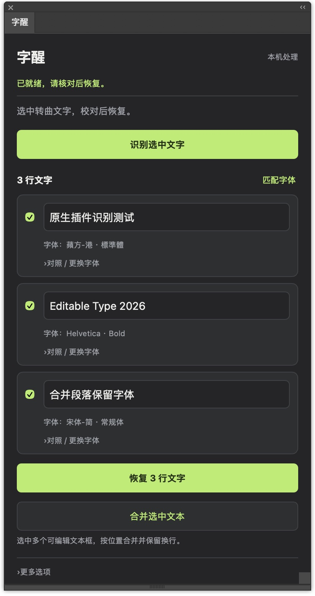
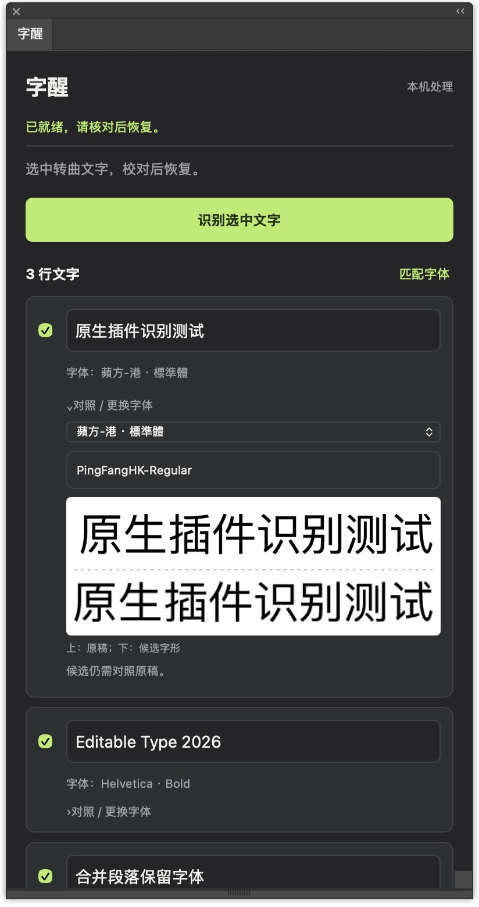
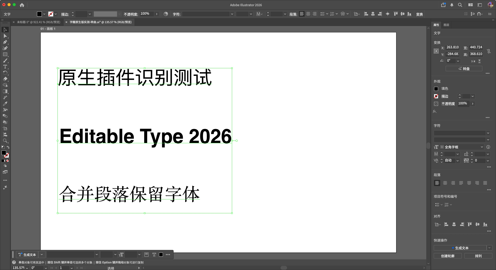
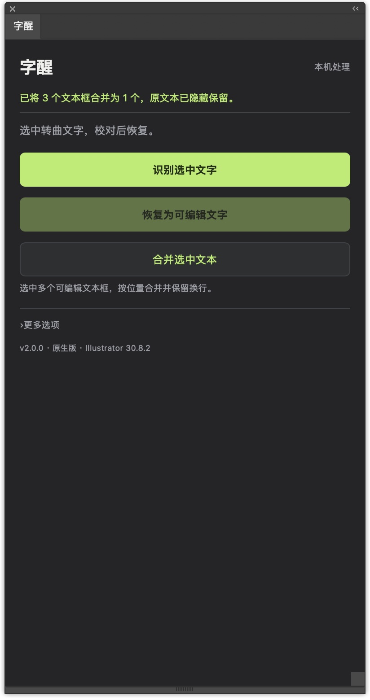

# ZiXing · 字醒

[简体中文](README.md) | **English**

Recover outlined text as editable text in Adobe Illustrator, and combine multiple text frames into one.

ZiXing recognizes the text locally, then compares the original shapes against fonts installed on your computer. Review the text, choose a font candidate, and rebuild editable text that you can modify and restyle. Original outlines and text frames are retained so you can return to them.

> Converting text to outlines removes its text and font information. ZiXing provides OCR and visual font candidates; it cannot guarantee the exact original font. Missing fonts, decorative lettering, and distorted text require particular care.

## Screenshots

These are actual screenshots of **the macOS native version 2.0.0 in Illustrator 30.8.2**, captured using a dedicated sample document. The plugin interface is currently in Chinese; this English README does not add an English interface. These screenshots do not establish Windows compatibility.

### Recognize text, review each line, and compare font shapes

After recognition, you can edit each line and choose which lines to restore. Expand **对照 / 更换字体** (Compare / Change font) to see the **original on top and the candidate below**, or choose another installed font. Always review the candidate against the original.

<p>
  
  
</p>

### Restore editable text and merge text frames

Restored text can be edited and assigned another font. Select multiple editable text frames and click **合并选中文本** (Merge selected text) to combine them by position while retaining line breaks and character styles. Original frames are hidden and retained. The sample below shows three restored frames merged into one editable object, with different fonts on the three lines.



<details>
<summary>Show the merge confirmation</summary>

<p></p>
</details>

## Downloads

Download the installer for your operating system from [Releases](https://github.com/Gerald-Charles/zixing/releases). The automatically generated source ZIP is not an installable plugin.

| Release | Compatibility target and verification status | Download |
| --- | --- | --- |
| macOS 2.0.0 | macOS 13+, Universal arm64 / x86_64. Recognition, recovery, and merging tested on Apple Silicon with Illustrator 2026 30.8.2. Other machines and Intel Macs have not been tested. | [Mac package](https://github.com/Gerald-Charles/zixing/releases/tag/v2.0.0-macos) |
| Windows 2.1.0-beta1 | Windows 10/11 x64, targeting Illustrator 2020–2026. **Not yet tested in Windows Illustrator.** | [Windows test package](https://github.com/Gerald-Charles/zixing/releases/tag/v2.1.0-beta1-windows) |

The Mac package has a local ad-hoc signature and has not been Developer ID signed or notarized; Gatekeeper may restrict it after download. The Windows package has no commercial digital signature and remains a test build. Keep your security protections enabled and try the plugin on a disposable document copy first.

## Installation and use

1. Save your work and quit Illustrator.
2. Extract the release package for your operating system. Copy `字醒.aip` into that Illustrator installation's `Plug-ins` folder. On Mac, copy the entire `.aip` bundle.
3. Restart Illustrator and open **Window → 字醒**.
4. Select outlined text, click **识别选中文字** (Recognize selected text), review its content and font candidates, then restore it as editable text. Font comparison progress appears at the top of the panel.
5. To combine text frames, select multiple editable text frames and click **合并选中文本** (Merge selected text).

The Windows version requires **.NET Framework 4.8** and **Microsoft Edge WebView2 Evergreen Runtime**. It opens in a separate floating window rather than a docked Illustrator panel. The Windows package includes detailed installation instructions, runtime download links, a sample script, and a testing checklist.

| Chinese control | Meaning |
| --- | --- |
| 识别选中文字 | Recognize selected text |
| 匹配字体 | Compare installed fonts |
| 对照 / 更换字体 | Compare original and candidate / change font |
| 确认文字 | Confirm reviewed text |
| 恢复为可编辑文字 | Restore as editable text |
| 合并选中文本 | Merge selected editable text frames |
| 更多选项 | More options |

Results depend on the text, selection, shape distortion, and available fonts. Windows uses local Tesseract OCR; Mac uses Apple Vision, so results differ. In the Windows offline OCR sample, two ordinary English / mixed Chinese-English lines were recognized correctly, while a decorative-font line was misread. Correct the content before comparing fonts.

## Source layout

| Directory | Contents |
| --- | --- |
| `aip/` | macOS native plugin, WebKit panel, and Illustrator bridge |
| `native/` | macOS local OCR and font-matching helpers |
| `windows/` | Windows native plugin, WebView2 window, offline OCR interface, and font matcher |
| `extension/` | Earlier CEP implementation and shared logic; not the installation entry point for the current native release |
| `tests/` | Public core-logic and simulated-host tests |

The repository excludes the Adobe SDK, commercial fonts, user artwork, local font inventories, and temporary build outputs. Installable packages are provided separately in Releases.

## Development and checks

Obtain the Adobe SDK separately from Adobe Developer Console and follow its terms. It is not distributed with this repository.

**Mac:** run `bash tools/build.sh` to compile the helpers, then `bash aip/tools/build-aip.sh 'SDK root'`. Xcode command-line tools and the Illustrator 2026 Mac SDK are required. See the [Mac development notes](aip/README.md) (Chinese).

**Windows:** run `python3 windows/tools/fetch-ocr-assets.py` to download pinned OCR build assets and verify their hashes. Then prepare the official SDK and build tools described in the [Windows development notes](windows/README.md) (Chinese). Release packages already embed the OCR assets and do not need to download models during use.

JavaScript checks that do not require Illustrator:

```sh
node --test tests/core.test.cjs tests/panel.test.cjs tests/merge-host.test.cjs aip/tests/runtime.test.cjs windows/tests/runtime.test.cjs
```

Windows still needs real-machine verification of plugin loading, font enumeration, recovery, merging, and undo. See the [Windows verification report](windows/验证报告.md) (Chinese). Passing automated or simulated checks does not establish that a feature works in Illustrator.

## Feedback

Open an [Issue](https://github.com/Gerald-Charles/zixing/issues) with your operating system, full Illustrator version, ZiXing version, reproduction steps, and an error screenshot. Only share sample files that are safe to publish; do not upload client artwork or sensitive files.

Third-party notices are in `windows/resources/licenses/` and are also included in the relevant release package.
